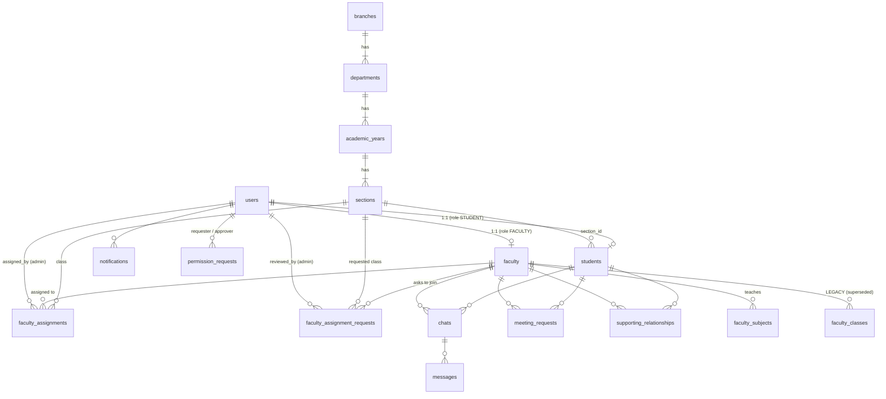
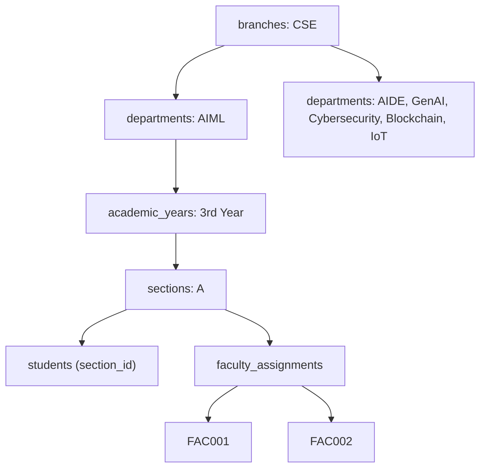

# Campus Connect — Database Documentation

SQLite database, schema defined in `models/schema.sql`, all access through parameterized
statements in `models/queries.py` and `models/academic_queries.py`. Foreign keys are enforced
(`PRAGMA foreign_keys = ON`, set per-connection in `models/database.py`). The file location comes
from `DATABASE_PATH` (default `./database.db`; `/var/data/campusconnect.db` on Render). WAL mode
is enabled at start-up, so `-wal` / `-shm` sidecar files appear next to the database.

**The database file is never committed** (`*.db`, `*.db-wal`, `*.db-shm` are git-ignored). The
`database.db` that may exist in a working copy is a local, empty development database.

## Entity relationships



### Academic hierarchy (the part Admin controls)



Example path: `CSE → AIML → 3rd Year → A → FAC001, FAC002`. See
[`docs/ACADEMIC_HIERARCHY.md`](docs/ACADEMIC_HIERARCHY.md) for the rules built on top of it.

## Tables

### `users`
Common account table for all three roles.
| Column | Type | Notes |
|---|---|---|
| id | INTEGER PK | |
| role | TEXT | `STUDENT` / `FACULTY` / `ADMIN` |
| email | TEXT UNIQUE | login identifier (college email for students, professional email for faculty) |
| password_hash | TEXT | Werkzeug hash, never plaintext |
| full_name | TEXT | |
| profile_picture_path | TEXT | relative path under the uploads root |
| is_active | INTEGER | |
| theme_preference | TEXT | `light` / `dark` |
| last_login_at | TEXT | set on successful login (added by additive migration) |
| created_at / updated_at | TEXT | |

### `students` / `faculty`
One row per student/faculty account, 1:1 with `users` via `user_id`.
- `students.usn` — unique, validated `^[A-Za-z0-9]{6,15}$`.
- `students.section_id` — FK to `sections.id` (`ON DELETE SET NULL`), indexed
  (`idx_students_section`). This is the authoritative class of the student. `NULL` only for
  legacy rows that could not be mapped. The text columns `branch / department / year / section`
  are a denormalised snapshot of the names at registration time (kept in sync by
  `academic_queries.set_student_section`).
- `students.class_faculty_id` — **legacy**, FK to `faculty.id`, `ON DELETE SET NULL`. No longer
  used for access decisions; class-based access comes from `faculty_assignments`.
- `faculty.faculty_code` — unique Faculty ID.

### `faculty_subjects` / `faculty_classes`
`faculty_subjects` is a many-per-faculty child table (subjects taught).

`faculty_classes` (free-text branch / department / year / section) is **legacy and superseded**
by `faculty_assignments`. It is kept so old data is not lost; `backfill_legacy_data()` converts
matching rows into assignments, and nothing reads it for authorization.

### `branches` / `departments` / `academic_years` / `sections`
The Admin-controlled hierarchy. Each table has `is_active` and `created_at`; children reference
their parent with `ON DELETE CASCADE`.

| Table | Key columns | Uniqueness |
|---|---|---|
| `branches` | `name` | `name` (case-insensitive) |
| `departments` | `branch_id`, `name` | `(branch_id, name)` |
| `academic_years` | `department_id`, `name` (e.g. `3rd Year`), `sort_order` | `(department_id, name)` |
| `sections` | `academic_year_id`, `name` (single letter) | `(academic_year_id, name)` |

Seeded on first start with CSE, six departments (AIML, AIDE, GenAI, Cybersecurity, Blockchain,
IoT), four years and sections A to C.

### `faculty_assignments`
Faculty ↔ section (class) link: `faculty_id`, `section_id`, `is_active`, `assigned_by`
(admin `users.id`), `created_at`, `deactivated_at`; `UNIQUE(faculty_id, section_id)`. One faculty
has many rows; one section can have many faculty. Removal is a soft delete; re-assigning flips
the same row back to active. This is the table `is_student_in_faculty_scope` joins on.

### `faculty_assignment_requests`
A faculty member's request to join a class: `faculty_id`, `section_id`,
`status` (`PENDING` / `APPROVED` / `REJECTED`), `note`, `reviewed_at`, `reviewed_by`. Nothing is
granted until Admin approves, which creates or re-activates the `faculty_assignments` row.

### `login_attempts`
Failed / successful login tracking used for throttling and temporary lockout:
`identifier` (normalised email), `ip`, `success`, `created_at`; indexed by
`(identifier, created_at)` and `(ip, created_at)`. Rows are only counted inside the lockout window
(15 minutes, `LOGIN_WINDOW_MINUTES`).

### `captcha_challenges`
One row per issued image captcha (created by `models/security_queries.ensure_schema`). Stores only an
**HMAC** of the answer (`answer_hash`, keyed with `SECRET_KEY`), `expires_at` (5 minutes), the requesting `ip`
and `created_at`. A row is deleted the first time it is checked (right or wrong), so each challenge gets exactly
one guess. The plaintext answer is never persisted. (The former `otp_sessions` / `otp_requests` tables are
dropped on start-up.)

### `permission_requests`
Drives both approval workflows (student→faculty, faculty→admin) through one table.
`request_type` distinguishes `STUDENT_PROFILE_CHANGE` / `FACULTY_PROFILE_CHANGE`.
`requested_changes` stores a JSON object of `{field: new_value}`, validated server-side
against an allow-list (`permission_service.STUDENT_EDITABLE_FIELDS` /
`FACULTY_EDITABLE_FIELDS`) before it is ever written — the client cannot request a
change to an arbitrary column. A student can only ask to change phone / personal e-mail (never
their class). Changes are applied to `students`/`faculty` only when `status` transitions to
`APPROVED`.

### `supporting_relationships`
One row per student/faculty pair that has ever exchanged a supporting-relationship
request. `requested_by` records which side initiated it, so the correct side is
prevented from "accepting" their own request. `UNIQUE(student_id, faculty_id)` — a
second request cannot be created while one is `PENDING` or `ACCEPTED` (enforced in
`supporting_service`, not by the DB constraint alone, so a REJECTED relationship can
be re-requested later). An `ACCEPTED` row is the only way to reach someone outside the
assigned classes.

### `chats` / `messages`
One `chats` row per student/faculty pair (`UNIQUE(student_id, faculty_id)`), created
lazily on first message. `messages.is_seen` / `seen_at` drive both the unread-count
badges and the edit-lock rule: `chat_service.edit_message` refuses to edit once
`is_seen = 1`. Messages are never deleted; `is_edited` simply flips to `1` and the
template renders an "edited" marker.

### `meeting_requests`
The core workflow table. `status` is constrained to
`PENDING / ACCEPTED / REJECTED / COMPLETED / CANCELLED` and `meeting_service.py`
enforces the transition graph in `VALID_TRANSITIONS` (see `ESD.md` section 32) —
routes never write `status` directly. `meeting_time_text` is free text entered by
faculty; there is intentionally no start/end datetime column, no duration column, and
no calendar/slot table anywhere in the schema, per the "no booking calendar, no fixed
duration" requirement. `last_reminder_at` lets the reminder job (APScheduler, see
`services/meeting_service.send_due_reminders`) avoid sending duplicate reminders within
`Config.REMINDER_INTERVAL_MINUTES`.

### `notifications`
Generic in-app notification log. `related_entity_type` / `related_entity_id` let the UI
link back to the meeting/chat/relationship/permission-request that triggered it.
`notification_service.py` centralizes every `notification_type` constant used across
the app so callers cannot introduce ad-hoc, undocumented types.

## Migrations and backfill

There is no migration framework. `models/database.init_db()` runs on every start and is
**additive and idempotent**:

1. `schema.sql` is executed (`CREATE TABLE / INDEX IF NOT EXISTS`), which adds the hierarchy,
   assignment, request and `login_attempts` tables to an older database.
2. `_migrate()` inspects `PRAGMA table_info` and runs `ALTER TABLE ... ADD COLUMN` for
   `students.section_id` (plus `idx_students_section`) and `users.last_login_at` only when they
   are missing. Nothing is dropped or rewritten.
3. `academic_service.seed_default_structure()` seeds CSE only if `branches` is empty.
4. `academic_service.backfill_legacy_data()` links `students` rows with `section_id IS NULL`
   to a section when their free-text branch/department/year/section match an Admin structure
   (`3A` is normalised to `A`), and converts `faculty_classes` rows into `faculty_assignments`.
   Unmatched rows are left as they are and show as "unmapped" to Admin.

Running it twice changes nothing. The legacy `faculty_classes` table and the
`students.class_faculty_id` column remain in the schema but are superseded.

To start completely fresh locally, stop the app and delete the database file (and its `-wal` /
`-shm` files).

## Backups

Use SQLite's online backup, never a plain file copy of a live WAL database:

```bash
# sqlite3 CLI
sqlite3 /var/data/campusconnect.db ".backup '/var/data/backups/campusconnect-$(date +%F).db'"

# or, no CLI needed (uses the same backup API, verifies integrity, prunes old copies)
python scripts/backup_db.py --dest /var/data/backups --keep 14
```

See `DEPLOYMENT.md` for the production routine and restore procedure.

## Indexes

Every foreign key used in a lookup path has a matching index (`idx_students_usn`,
`idx_students_section`, `idx_faculty_code`, `idx_fassign_faculty`, `idx_fassign_section`,
`idx_chats_student` / `idx_chats_faculty`, `idx_meetings_student` / `idx_meetings_faculty`,
`idx_notifications_user`, `idx_login_attempts_ident`, etc.) — see `models/schema.sql` for the
full list.

## Why one file (`schema.sql`) instead of an ORM

The ESD calls for a project a college team can understand end-to-end. Raw SQL in one
file plus thin data-access modules (`queries.py`, `academic_queries.py`) keeps every table
definition and every query visible and auditable, at the cost of not having ORM-level
relationship traversal — an acceptable tradeoff at this project's scale. The flip side is that
moving to PostgreSQL would need a DB-layer port (see `DEPLOYMENT.md`).
