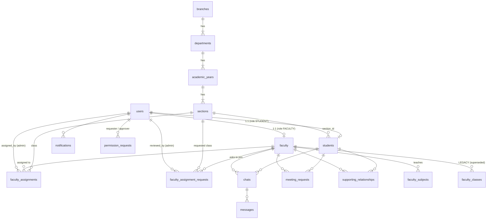
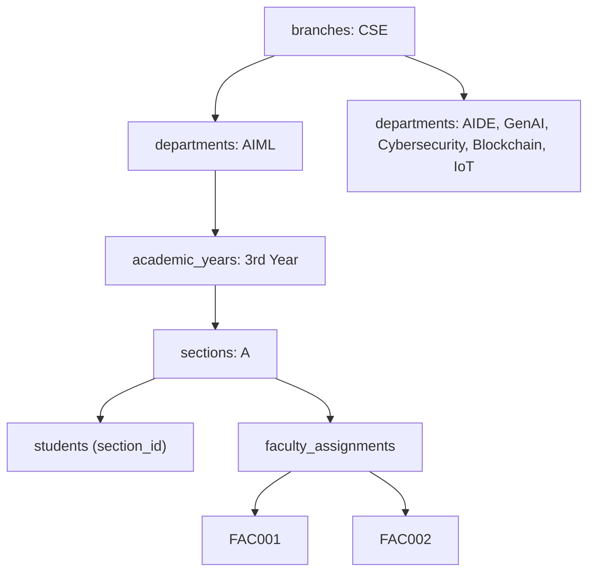

# Campus Connect — Database Documentation

**PostgreSQL** (hosted on **Neon**, Free plan). The schema is defined by the numbered SQL files in
`migrations/`; all access goes through parameterized statements in `models/*.py`. Foreign keys are enforced by
PostgreSQL. SQLite is no longer used at runtime (it only appears as the *source* of the one-off import script
`scripts/migrate_sqlite_to_postgres.py`).

## Connection model

* Driver: **psycopg 3** with `psycopg_pool` (`api/db.py`). One pooled connection is checked out lazily per request
  and returned at the end; uncommitted work is **rolled back** on return. Outside a request (scripts, scheduler,
  tests, startup) use `with db_session() as db:`.
* **Runtime** uses the **pooled** Neon URL (`DATABASE_URL_POOLED`, PgBouncer transaction mode). Because of that,
  server-side prepared statements are disabled. TLS comes from `sslmode=require` in the URL. Pool: max 5
  connections (`DB_POOL_MAX`), 15 s wait for a free connection, 15 s connect timeout (covers a Neon compute waking
  from scale-to-zero), connection attempts retried with backoff.
* **Migrations and maintenance** use the **direct** URL (`DATABASE_URL`) under a PostgreSQL advisory lock.
* If the database is unreachable the API answers `503` with `Retry-After`; a unique-constraint race answers `409`.
* `models/*.py` still contain SQLite-style SQL (`?` placeholders, `datetime('now')`, `LIKE`, `COLLATE NOCASE`,
  `lastrowid`). `api/db.py` translates it on the fly: `?` -> `%s`, `datetime('now')` -> `cc_now()`, `LIKE` ->
  `ILIKE`, `COLLATE NOCASE` dropped (the columns are `citext`), `INSERT` without `RETURNING` gets `RETURNING id`.
* `api/db.transaction()` groups several statements atomically (used for registration, approvals, invitation
  acceptance).

## Type conventions

| Concept | PostgreSQL type | Notes |
|---|---|---|
| Timestamps | `TEXT` `'YYYY-MM-DD HH:MM:SS'`, **UTC** | Same shape the SQLite app stored, so string comparisons keep working. Defaults use `cc_now()`. |
| Case-insensitive identifiers | `CITEXT` | e-mail, USN, faculty code, branch/department/year/section names (needs the `citext` extension, created by migration 0001). |
| Flags | `INTEGER` `0/1` | `is_active`, `is_seen`, `is_verified`, ... (not `BOOLEAN`). |
| Keys | `INTEGER GENERATED BY DEFAULT AS IDENTITY` | Except `file_blobs.path`, `captcha_challenges.id`, `presence.user_id`, `schema_migrations.version`. |
| Binary | `BYTEA` | Only `file_blobs.content`. |

## Entity relationships



### Academic hierarchy (the part Admin controls)



Example path: `CSE → AIML → 3rd Year → A → FAC001, FAC002`. See
[`docs/ACADEMIC_HIERARCHY.md`](docs/ACADEMIC_HIERARCHY.md) for the rules built on top of it.

## Tables

### `users`
Common account table for all three roles.
| Column | Type | Notes |
|---|---|---|
| id | INTEGER PK | |
| role | TEXT | `STUDENT` / `FACULTY` / `ADMIN` |
| email | CITEXT UNIQUE | login identifier (college email for students, professional email for faculty) |
| password_hash | TEXT | **Argon2id** (OWASP profile); legacy werkzeug hashes still verify and are upgraded at the next login. Never plaintext. |
| full_name | TEXT | |
| profile_picture_path | TEXT | relative key into `file_blobs` (`profile/<role>/<uuid>.<ext>`) |
| is_active | INTEGER | |
| theme_preference | TEXT | `light` / `dark` |
| last_login_at | TEXT | set on successful login |
| session_version | INTEGER | added by 0002. Stored in the session cookie; password change/reset/deactivation bumps it, which ends all other sessions of that user. |
| created_at / updated_at | TEXT | |

The primary admin (`PRIMARY_ADMIN_EMAIL`) is re-activated at every start if it was somehow deactivated and cannot be
deactivated or deleted through the API.

### `students` / `faculty`
One row per student/faculty account, 1:1 with `users` via `user_id`.
- `students.usn` — unique, validated `^[A-Za-z0-9]{6,15}$`.
- `students.section_id` — FK to `sections.id` (`ON DELETE SET NULL`), indexed
  (`idx_students_section`). This is the authoritative class of the student. `NULL` only for
  legacy rows that could not be mapped. The text columns `branch / department / year / section`
  are a denormalised snapshot of the names at registration time (kept in sync by
  `academic_queries.set_student_section`).
- `students.class_faculty_id` — **legacy**, FK to `faculty.id`, `ON DELETE SET NULL`. No longer
  used for access decisions; class-based access comes from `faculty_assignments`.
- `faculty.faculty_code` — unique Faculty ID.

### `faculty_subjects` / `faculty_classes`
`faculty_subjects` is a many-per-faculty child table (subjects taught).

`faculty_classes` (free-text branch / department / year / section) is **legacy and superseded**
by `faculty_assignments`. It is kept so old data is not lost; `backfill_legacy_data()` converts
matching rows into assignments, and nothing reads it for authorization.

### `branches` / `departments` / `academic_years` / `sections`
The Admin-controlled hierarchy. Each table has `is_active`, `is_verified` (0003) and `created_at`; children reference
their parent with `ON DELETE CASCADE`.

| Table | Key columns | Uniqueness |
|---|---|---|
| `branches` | `name` | `name` (case-insensitive) |
| `departments` | `branch_id`, `name` | `(branch_id, name)` |
| `academic_years` | `department_id`, `name` (e.g. `3rd Year`), `sort_order` | `(department_id, name)` |
| `sections` | `academic_year_id`, `name` (single letter) | `(academic_year_id, name)` |

Seeded on first start with CSE, six departments (AIML, AIDE, GenAI, Cybersecurity, Blockchain,
IoT), four years and sections A to C (plus extra branches such as ECE, ISE, Mechanical unless `SEED_EXTRA_BRANCHES=0`).

`is_verified`: official (seeded or admin-created) rows are `1`. A class typed in by a student or faculty member at signup is stored with `is_verified = 0` and stays out of the public pickers until an admin calls `POST /api/admin/academics/{level}/{id}/verify`.

### `faculty_assignments`
Faculty ↔ section (class) link: `faculty_id`, `section_id`, `is_active`, `assigned_by`
(admin `users.id`), `created_at`, `deactivated_at`; `UNIQUE(faculty_id, section_id)`. One faculty
has many rows; one section can have many faculty. Removal is a soft delete; re-assigning flips
the same row back to active. This is the table `is_student_in_faculty_scope` joins on.

### `faculty_assignment_requests`
A faculty member's request to join a class: `faculty_id`, `section_id`,
`status` (`PENDING` / `APPROVED` / `REJECTED`), `note`, `reviewed_at`, `reviewed_by`. Nothing is
granted until Admin approves, which creates or re-activates the `faculty_assignments` row.


### `login_attempts`
Failed / successful login tracking used for throttling and temporary lockout:
`identifier` (normalised email), `ip`, `success`, `created_at`; indexed by
`(identifier, created_at)` and `(ip, created_at)`. Rows are only counted inside the lockout window
(15 minutes, `LOGIN_WINDOW_MINUTES`).

### `captcha_challenges`
One row per issued image captcha (baseline migration). Stores only an
**HMAC** of the answer (`answer_hash`, keyed with `SECRET_KEY`), `expires_at` (5 minutes), the requesting `ip`
and `created_at`. A row is deleted the first time it is checked (right or wrong), so each challenge gets exactly
one guess. The plaintext answer is never persisted.

### `permission_requests`
Drives both approval workflows (student→faculty, faculty→admin) through one table.
`request_type` distinguishes `STUDENT_PROFILE_CHANGE` / `FACULTY_PROFILE_CHANGE`.
`requested_changes` stores a JSON object of `{field: new_value}`, validated server-side
against an allow-list (`permission_service.STUDENT_EDITABLE_FIELDS` /
`FACULTY_EDITABLE_FIELDS`) before it is ever written — the client cannot request a
change to an arbitrary column. A student can only ask to change phone / personal e-mail (never
their class). Changes are applied to `students`/`faculty` only when `status` transitions to
`APPROVED`.

### `supporting_relationships`
One row per student/faculty pair that has ever exchanged a supporting-relationship
request. `requested_by` records which side initiated it, so the correct side is
prevented from "accepting" their own request. `UNIQUE(student_id, faculty_id)` — a
second request cannot be created while one is `PENDING` or `ACCEPTED` (enforced in
`supporting_service`, not by the DB constraint alone, so a REJECTED relationship can
be re-requested later). An `ACCEPTED` row is the only way to reach someone outside the
assigned classes.

### `chats` / `messages`
One `chats` row per student/faculty pair (`UNIQUE(student_id, faculty_id)`), created
lazily on first message (`INSERT ... ON CONFLICT DO NOTHING`, so concurrent first messages share one row). `messages.is_seen` / `seen_at` drive both the unread-count
badges and the edit-lock rule: `chat_service.edit_message` refuses to edit once
`is_seen = 1`. Messages are never deleted; `is_edited` simply flips to `1` and the
template renders an "edited" marker.

### `meeting_requests`
The core workflow table. `status` is constrained to
`PENDING / ACCEPTED / REJECTED / COMPLETED / CANCELLED` and `meeting_service.py`
enforces the transition graph in `VALID_TRANSITIONS` (see `ESD.md` section 32) —
routes never write `status` directly. `meeting_time_text` is free text entered by
faculty; there is intentionally no start/end datetime column, no duration column, and
no calendar/slot table anywhere in the schema, per the "no booking calendar, no fixed
duration" requirement. `last_reminder_at` lets the reminder job (APScheduler, see
`services/meeting_service.send_due_reminders`) avoid sending duplicate reminders within
`REMINDER_INTERVAL_MINUTES`; the claim is one atomic UPDATE (`claim_meeting_reminder`).

### `notifications`
Generic in-app notification log. `related_entity_type` / `related_entity_id` let the UI
link back to the meeting/chat/relationship/permission-request that triggered it.
`notification_service.py` centralizes every `notification_type` constant used across
the app so callers cannot introduce ad-hoc, undocumented types.


### `admin_messages`
Direct messages between an admin and a faculty member (same message features as `chats`/`messages`: seen/delivered,
edit, unsend, "delete for me", replies).

### `admin_invitations` (migration 0002)
Admin registrations created by the primary admin (nothing is e-mailed). `email` (CITEXT), `full_name`, `token_hash`
(legacy column, filled with a random hash and no longer used for any link), `status` (`PENDING` / `ACCEPTED` /
`REVOKED`; `EXPIRED` is derived from `expires_at`), `invited_by`, `expires_at` (default now + `INVITE_TTL_HOURS`,
720 h), `last_sent_at`, `send_count`, `delivery_status` (legacy, always `NOT_SENT`), `accepted_at`, `accepted_user_id`.
A partial unique index allows **one `PENDING` row per e-mail**. The row turns `ACCEPTED` when that person signs in
at Admin Login for the first time (the admin account is created then). Resend renews `expires_at` (60 s cooldown).

### `file_blobs` (migration 0002)
All uploads: `path` (PK, the key used in URLs: `chat/<uuid>.<ext>` or `profile/<students|faculty>/<uuid>.<ext>`),
`content` (BYTEA), `content_type`, `size_bytes`, `created_at`. Written on the request's own connection, so a
failed message/profile write never leaves an orphaned upload. Caps: 8 MB per chat attachment, 3 MB per profile
picture. Neon Free offers 0.5 GB for the whole database; to move uploads to R2/S3 replace the three functions in
`services/storage.py`.

### `audit_log` (migration 0002)
Append-only trail of sensitive admin/account actions: `actor_user_id`, `actor_email`, `action` (for example
`admin_invite.create`, `admin.activate`, `admin.deactivate`, password change), `target`, `detail`, `ip`, `created_at`.

### `presence` (migration 0002)
`user_id` (PK) and `last_seen_epoch`. "Last active" survives restarts; writes are throttled to one per user per
interval.

### `schema_migrations`
`version` (PK), `name`, `applied_at`. Created by the migration runner, not by a migration file.

## Migrations

Files `migrations/NNNN_name.sql`, applied in order at **every app start** (also by `api.db.init_db()` in scripts):

1. A transaction-level advisory lock serialises concurrent starters.
2. Versions already present in `schema_migrations` are skipped; each remaining file runs in its own transaction
   together with its `schema_migrations` row.
3. Afterwards the app re-activates the primary admin if needed and seeds the default academic structure
   (`seed_default_structure()`: CSE with six departments, four years, sections A to C; plus the extra branches
   unless `SEED_EXTRA_BRANCHES=0`), then `backfill_legacy_data()` (links old free-text classes to sections).
   All of this is idempotent.

| Version | File | Content |
|---|---|---|
| 0001 | `0001_baseline.sql` | the whole schema of the former SQLite app, `citext`, `cc_now()` |
| 0002 | `0002_invitations_storage_audit.sql` | `admin_invitations`, `file_blobs`, `audit_log`, `presence`, `users.session_version`, extra indexes |
| 0003 | `0003_unverified_classes.sql` | `is_verified` (default 1) on `branches`, `departments`, `academic_years`, `sections` |

Rules: statements must be idempotent (`IF NOT EXISTS`, `ADD COLUMN IF NOT EXISTS`); never edit an applied file,
add the next number instead. Passkey tables do not exist any more (passkeys were removed entirely).

### Importing an old SQLite database

```bash
python scripts/migrate_sqlite_to_postgres.py --sqlite database.db --uploads uploads            # dry run (default)
python scripts/migrate_sqlite_to_postgres.py --sqlite database.db --uploads uploads --apply
```

Copies rows and uploaded files (into `file_blobs`) into PostgreSQL. It refuses to write into non-empty tables,
never deletes anything, and skips admin accounts unless `--include-admins` is given.

## Reliability notes

* Registration and approvals run in `db.transaction()` (all-or-nothing).
* Meeting status changes are guarded updates (`UPDATE ... WHERE status = ...`), so two concurrent responses cannot
  both win.
* Chat creation uses `INSERT ... ON CONFLICT (student_id, faculty_id) DO NOTHING`.
* Reminders are claimed atomically (`claim_meeting_reminder`), so a reminder is sent once even with overlapping
  runs.
* Changing a faculty member's `professional_email` updates `users.email` in the same transaction.
* List queries are bounded: the newest 300 messages per thread request, admin "list everything" views capped at
  2000 rows, invitations at 200.
* A unique-violation race surfaces as `409`; an unreachable database as `503` + `Retry-After`.

## Backups

* **Neon point-in-time restore / branching** (7-day window on Free) is the first line of defence.
* **Logical JSON backup/restore via psycopg** (no `pg_dump` needed on Render):

```bash
python scripts/backup_db.py --out backups/
python scripts/restore_db.py backups/<file>.json.gz --apply      # refuses a non-empty target
```

See `DEPLOYMENT.md` section 5 for the routine and the restore procedure. Uploads are in `file_blobs`, so they are
included.

## Indexes

Every foreign key used in a lookup path has a matching index (`idx_students_usn`, `idx_students_section`,
`idx_faculty_code`, `idx_fassign_faculty`, `idx_fassign_section`, `idx_chats_student` / `idx_chats_faculty`,
`idx_messages_chat_id`, `idx_meetings_student` / `idx_meetings_faculty`, `idx_notifications_user_created`,
`idx_login_attempts_ident`, `idx_audit_log_created`, ...) — see `migrations/*.sql` for the full list.

## Why plain SQL files instead of an ORM

The ESD calls for a project a college team can understand end-to-end. Numbered SQL migrations plus thin
data-access modules (`models/*.py`) keep every table definition and every query visible and auditable, at the cost
of not having ORM-level relationship traversal — an acceptable tradeoff at this project's scale.
