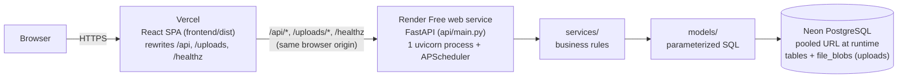

# Campus Connect

A college web application connecting students and faculty for academic communication
(**Mentor-Connect**), faculty meeting requests, supporting-faculty relationships, notifications and
administration, plus a separate scheduling-research component.

Campus Connect is a **React single-page app** (`frontend/`) talking to a **FastAPI JSON API**
(`api/`) that stores everything, uploads included, in **Neon PostgreSQL**. It deploys on free tiers: Vercel
(SPA), Render Free (API) and Neon Free (database). See `PRD.md` for the product requirements and `ESD.md`
for the engineering design (both carry a changelog for the architecture migration).

| Document | What it covers |
|---|---|
| [`DEPLOYMENT.md`](DEPLOYMENT.md) | Neon + Render Free + Vercel step by step, env tables, free-tier limits, first admin, smoke checklist, backups, restore, key rotation |
| [`DATABASE.md`](DATABASE.md) | Every table, ER and hierarchy diagrams, connection model, numbered migrations |
| [`docs/KEEP_ALIVE.md`](docs/KEEP_ALIVE.md) | Optional keep-alive ping for the sleeping Render Free service |
| [`docs/ACADEMIC_HIERARCHY.md`](docs/ACADEMIC_HIERARCHY.md) | Branch / Department / Year / Section model, Admin authority, access rules |
| [`docs/api/README.md`](docs/api/README.md) | Index of the API documentation (conventions, architecture, per-area endpoints) |
| [`frontend/README.md`](frontend/README.md) | SPA structure, design tokens, API client, how to add a page |
| [`research/README.md`](research/README.md) | Scheduling experiment: method, data, metrics, results |
| `.env.example` | Every environment variable the backend reads, plus the frontend ones (placeholders only) |

## 1. Architecture



Render Free has no persistent disk and sleeps after ~15 minutes idle (cold start up to ~60 s; the UI shows a
"waking the server" banner and retries idempotent GETs), so the API keeps no local state.

* The browser only ever talks to **one origin**. In production Vercel serves the SPA and proxies
  `/api/*` and `/uploads/*` to Render, so the `cc_session` cookie is first-party and no CORS is needed. In
  development the Vite dev server (`:5173`) proxies the same paths to the API (`:5000`).
* The API can also serve the built SPA itself (`frontend/dist`, with an `index.html` fallback for client-side
  routes), which is handy for single-origin local runs.
* Layers: `api/routers` (HTTP, validation, auth) -> `services` (business rules, framework-agnostic) ->
  `models` (SQL). Details: [`docs/api/ARCHITECTURE.md`](docs/api/ARCHITECTURE.md).

## 2. Repository map

```
CampusConnect/
├── api/                    FastAPI app
│   ├── main.py             create_app(), lazy `app` (uvicorn api.main:app), router registration, scheduler
│   ├── settings.py         Settings dataclass + every environment variable
│   ├── security.py         ASGI middlewares: proxy headers, security headers / CSP, 10 MB cap, DB holder
│   ├── deps.py             auth / role / CSRF dependencies, request helpers
│   ├── db.py               psycopg pool, sqlite-style SQL translation, migration runner, init_db(), seed
│   ├── errors.py           JSON error handlers, SPA index fallback
│   ├── schemas.py          shared response shapes
│   └── routers/            system, auth, account, academic, notifications, uploads, admin,
│                           admin_academic, admin_messages, faculty, student, chat, meetings, supporting, research
├── services/               business logic (auth, captcha, academic, assignment, permission, chat, meeting,
│   │                       supporting, notification, file, storage, invitation, mail, audit, presence, session)
│   │                       + errors.py
│   └── scheduling/         RESEARCH ONLY: core engine, fcfs, rule_based, intelligent, metrics,
│                           simulator, experiment
├── migrations/             numbered PostgreSQL migrations (0001 baseline, 0002 invitations/file_blobs/audit/presence,
│                           0003 unverified classes), applied automatically at start
├── models/                 SQL modules (queries, academic_queries, admin_queries, connect_queries,
│                           security_queries); database.py is a shim to api/db.py
├── frontend/               React 19 + Vite + Tailwind v4 + shadcn/ui SPA (own README, vercel.json)
├── research/               scheduling experiment entry point, data/, results/
├── docs/                   ACADEMIC_HIERARCHY.md, api/ (API contract and per-area endpoint docs)
├── tests/                  pytest suite (FastAPI TestClient, throw-away PostgreSQL database per pytest process)
├── scripts/                migrate_sqlite_to_postgres.py (one-off import), backup_db.py / restore_db.py
│                           (logical JSON backup/restore), start-dev.ps1
├── app.py                  tiny local runner (uvicorn)
├── create_admin.py         CLI: create an admin (interactive or --from-env)
├── render.yaml             Render Blueprint (free plan, no disk)
├── requirements.txt        runtime dependencies          requirements-dev.txt   + pytest, httpx
├── requirements-research.txt   optional: matplotlib for the research charts
├── .env.example            documented environment variables
└── .github/workflows/ci.yml   backend tests + frontend lint/build
```

## 3. Local development

Requires Python 3.12 and Node 24 (any recent Node works).

### Backend (Windows)

```powershell
cd C:\dev\CampusConnect
python -m venv venv
venv\Scripts\python.exe -m pip install -r requirements-dev.txt     # runtime + test tools
copy .env.example .env                                              # then edit .env (git-ignored)

venv\Scripts\python.exe -m uvicorn api.main:app --reload --port 5000
# or the tiny runner (DEBUG=1 enables reload and the /docs pages):
venv\Scripts\python.exe app.py
```

macOS/Linux: `python3 -m venv venv && venv/bin/pip install -r requirements-dev.txt`, then
`venv/bin/python -m uvicorn api.main:app --reload --port 5000`.

Settings come from environment variables; a local `.env` is loaded automatically (real environment
variables win). In development with no `SECRET_KEY` a random key is stored in `.dev_secret_key`
(git-ignored) so sessions survive restarts. In production (`APP_ENV=production`) a strong `SECRET_KEY` is
mandatory. Every variable is listed in `.env.example`; the interactive API docs at `/docs` are only available
with `DEBUG=1`.

### Frontend

For a first local run on Windows, install Python 3.12+ and Node.js 20+, then run this from the
repository root:

```powershell
Set-ExecutionPolicy -Scope Process Bypass
.\scripts\start-dev.ps1
```


Change or remove those values in `.env` before using the project beyond local development. The
launcher never replaces an existing `.env` or an existing admin password.

```powershell
cd frontend
npm install
npm run dev          # http://localhost:5173, proxies /api /uploads /healthz to http://127.0.0.1:5000
npm run dev:mock     # same, with an in-memory API mock (no backend needed)
npm run lint
npm run build        # -> frontend/dist (the API serves it when present)
```

Set `VITE_BACKEND_URL` to point the dev proxy somewhere other than `http://127.0.0.1:5000`.

### Database

The app needs a PostgreSQL database. Locally use any PostgreSQL 14+ server (or a free Neon branch) and put its
URLs in your git-ignored `.env`: `DATABASE_URL` (direct, used for migrations) and `DATABASE_URL_POOLED` (runtime;
if only one is set it is used for both). On start `api/db.init_db()` applies every `migrations/NNNN_name.sql` that
is not yet recorded in `schema_migrations` (under an advisory lock), seeds the default academic structure once and
links legacy free-text classes to it. Never commit `.env`. To start fresh locally, drop and recreate the database.
The old SQLite file can be imported once with `scripts/migrate_sqlite_to_postgres.py` (dry run by default). Details:
[`DATABASE.md`](DATABASE.md).

### Creating the first admin

There is **no public admin signup**. Choose one:

The **primary admin** (`PRIMARY_ADMIN_EMAIL`, default `mkkarthik0609@gmail.com`) is the owner account: it cannot
be deactivated or deleted, and only it can add further admins (Admin -> Admins; they sign in with e-mail + admin ID, see
[`docs/api/admin.md`](docs/api/admin.md)). The primary admin is created with:

```powershell
venv\Scripts\python.exe create_admin.py              # interactive (name, email, password prompts)
venv\Scripts\python.exe create_admin.py --from-env   # reads ADMIN_NAME, ADMIN_EMAIL, ADMIN_PASSWORD from the environment / .env
```

or set `BOOTSTRAP_ADMIN=1` with `ADMIN_NAME` / `ADMIN_EMAIL` / `ADMIN_PASSWORD` in `.env` (or the Render
dashboard) and the API creates that admin on start-up **only if the account does not exist** (an existing
password is never overwritten, and `ADMIN_PASSWORD` is dropped from the running process' environment afterwards).
After the first successful start remove `ADMIN_PASSWORD` and set `BOOTSTRAP_ADMIN=0`. Passwords need at least 8
characters with upper-case, lower-case and a digit. Put real values only in your private `.env` or the hosting
dashboard, never in tracked files.

### Tests

The backend tests need a **throw-away PostgreSQL server**. Set `TEST_DATABASE_ADMIN_URL` to a superuser connection
(default `postgresql://postgres@127.0.0.1:54329/postgres`); the suite creates and drops its own `cc_test_*`
databases. **Never point it at Neon production.**

```powershell
pip install -r requirements-dev.txt
python -m pytest tests -n 4
cd frontend; npm run lint; npm run build
```

CI (`.github/workflows/ci.yml`) runs the backend tests on Python 3.12 and the frontend `npm ci`, lint and
build on Node 24, on every push and pull request (check the workflow file for how it provides PostgreSQL).

## 4. Academic hierarchy (summary)

Admin owns the structure **Branch -> Department -> Year -> Section**. The default seed is branch `CSE` with
departments `AIML`, `AIDE`, `GenAI`, `Cybersecurity`, `Blockchain`, `IoT`, years `1st` to `4th` and sections
`A` to `C`.

- Students pick their class once at registration and cannot change it; Admin can **remove the registration**
  so the student can register again in the right class.
- Faculty have no classes at signup. Admin assigns them (many sections per faculty, several faculty per
  section) or approves their **class requests**.
- Faculty reach students, and students reach faculty, only through an active class assignment or an accepted
  supporting-faculty relationship, enforced server-side for chat, meetings, search, supporting requests and
  profile approvals.

Full rules and the file that implements each check: [`docs/ACADEMIC_HIERARCHY.md`](docs/ACADEMIC_HIERARCHY.md).

## 5. Demo usage

1. **Admin** signs in (account from section 3), reviews **Academics**, then **Assignments**.
2. **Faculty** registers (name, Faculty ID, department, subjects, professional email, password), then asks
   for classes, or Admin assigns them directly.
3. **Student** registers: college email, details including the Branch / Department / Year / Section, a password and
   an image captcha (letters + digits).
4. Users sign in with email (students and faculty can also use USN / Faculty ID).
5. The student opens **Mentor-Connect** to message the faculty assigned to their class, or finds other
   faculty and sends a **supporting-faculty request** (the faculty member must accept before chat or meetings
   are permitted).
6. The student sends a **meeting request**. Faculty accepts or rejects it and, on accept, types the time as
   free text (for example "Tomorrow after 3:30 PM"): no calendar, no fixed duration, no automatic slots.
7. Either party can mark a meeting **Completed** or **Cancel** it (students must give a reason). Open
   meetings keep receiving reminders; there is no automatic expiry.
8. Phone / personal-email changes need approval (student -> an in-scope class faculty; faculty changes ->
   Admin). Nothing is applied until approved.

## 6. Security features

- Email/password sign-in only (passkeys/WebAuthn were removed). Passwords are hashed with **Argon2id** (OWASP
  profile); legacy werkzeug hashes still verify and are upgraded at the next login; password policy enforced;
  college-email passwords are never requested.
- Sessions carry a `session_version`: a password change/reset or deactivation bumps it and ends the user's other
  sessions.
- Login throttling and temporary lockout (`login_attempts` table): 5 failures per identifier per 15 minutes, a
  per-IP hard limit of 150 (campus Wi-Fi shares one IP) and an image captcha after 10 failures per IP (3 per
  identifier); one generic error for unknown user / wrong password / inactive account.
- Admin registrations (primary admin only): admins have no password; they sign in with e-mail + the shared `ADMIN_ACCESS_ID` (demo-grade), failures are throttled and answer one generic error. Public signup cannot claim the primary admin's e-mail or any e-mail with a pending registration. Sensitive admin actions are written to `audit_log`.
- Signed session cookie `cc_session`: `HttpOnly`, `SameSite=Lax`, `Secure` in production, absolute (12 h) and
  idle (60 min) timeouts; the user's role and active flag are re-read from the database on every request.
- CSRF protection on every `POST/PUT/PATCH/DELETE` (header `X-CSRFToken`, constant-time comparison, enforced by
  one app-level dependency so no router can forget it).
- Security headers on every response (strict CSP with `script-src 'self'`, `X-Frame-Options: DENY`,
  `X-Content-Type-Options`, `Referrer-Policy`, `Permissions-Policy`, HSTS in production); every `/api/*`
  response is `Cache-Control: no-store`; 10 MB request cap.
- Strict request validation (pydantic, unknown fields rejected) and uniform JSON errors that never leak
  internals or raw database errors.
- Production refuses to start with a missing or short `SECRET_KEY`; no default admin credentials; secrets come
  only from the environment; `/docs` is disabled in production.
- Role and ownership checks are server-side (`api/deps.require_role` plus per-record checks in services);
  class-scope rules are in `docs/ACADEMIC_HIERARCHY.md`.
- Uploads (8 MB chat attachment, 3 MB profile picture) are validated by extension, size, magic bytes and file
  structure (Pillow decode, PDF `%%EOF`, docx zip with `word/`), stored in PostgreSQL (`file_blobs`) under
  generated names and served only to authorised signed-in users through `/uploads/*` (profile pictures: any
  signed-in user; chat files: the two participants only; non-images as downloads).
- All SQL is parameterized. Signup is protected by a single-use image captcha (answer HMAC-hashed at rest, issuing rate limited per IP); login adds one after repeated failures.
- Proxy-aware client IP (`TRUST_PROXY`, `TRUST_PROXY_HOPS`) so rate limiting works behind Vercel and Render.

## 7. Scheduling research (summary)

Kept entirely separate from the live application: it never touches real student or faculty accounts. Question:
can data-driven scheduling reduce student waiting time and improve meeting efficiency compared with the
manual approach? One simulated college week, three methods on identical synthetic requests: **FCFS / manual**,
**rule-based**, **intelligent** (transparent weighted scoring, no machine learning). Results, assumptions and
limitations: [`research/README.md`](research/README.md) and `research/results/comparison.md`. Run it with:

```powershell
venv\Scripts\python.exe -m pip install -r requirements-research.txt   # matplotlib, for the charts only
venv\Scripts\python.exe research\run_experiment.py
```

Admins can view the committed results (and rerun a quick simulation) in the SPA under **Research**
(`/api/research/*`, see `docs/api/research.md`).

## 8. Deployment summary

**Neon** (Free) holds all data including uploads; **Render** (Free plan, no disk) hosts the API as a single uvicorn
process with health check `/healthz`; **Vercel** hosts the React SPA and rewrites `/api`, `/uploads` and `/healthz`
to Render.

1. Neon: create a project near Render's Oregon region and copy the **direct** and **pooled** connection strings.
2. Render: *New -> Blueprint*, select the repo, enter `DATABASE_URL`, `DATABASE_URL_POOLED` and
   `ADMIN_NAME` / `ADMIN_EMAIL` / `ADMIN_PASSWORD`, apply. The first start runs the migrations. Afterwards remove
   `ADMIN_PASSWORD` and set `BOOTSTRAP_ADMIN=0`.
3. Vercel: *New Project*, import the repo, **Root Directory = `frontend`**; make sure the rewrites in
   `frontend/vercel.json` point at the Render URL (`npm run set-backend-url -- https://<service>.onrender.com`).
   Vercel needs no environment variables.

Step by step, free-tier limits, backups, restore and key rotation: [`DEPLOYMENT.md`](DEPLOYMENT.md).

## 8a. Architecture / Reliability

- All SQL stays in `models/*.py` in a sqlite-style dialect (`?`, `datetime('now')`); `api/db.py` translates it for
  PostgreSQL. Timestamps are TEXT `YYYY-MM-DD HH:MM:SS` (UTC), case-insensitive columns are `citext`, flags are
  INTEGER 0/1.
- Pooled Neon connection (PgBouncer transaction mode, no prepared statements, TLS, pool max 5, 15 s connect
  timeout, retries with backoff); uncommitted work is rolled back when the connection returns to the pool. If the
  database is unreachable the API returns `503` with `Retry-After`; a unique-violation race returns `409`.
- Registration and approvals are atomic (`db.transaction()`); meeting status changes are guarded updates
  (`UPDATE ... WHERE status = ...`); chat creation uses `INSERT ... ON CONFLICT DO NOTHING`; meeting reminders are
  claimed atomically (`claim_meeting_reminder`); presence is persisted (table `presence`, throttled).
- A faculty member's `professional_email` change updates `users.email` in the same transaction.
- Classes typed in at signup are stored `is_verified = 0` and hidden from public pickers until an admin calls
  `POST /api/admin/academics/{level}/{id}/verify`.
- List queries are bounded: newest 300 messages per thread request; admin lists capped at 2000 rows.
- `/healthz` never touches the database, so Render's health checks do not wake Neon.

## 9. Design constraints honored

No booking calendar, no fixed meeting duration, no automatic faculty availability, no automatic no-show or
expiry, no message deletion, no public admin signup, no college-email password storage, no e-mail/OTP verification, no paid captcha service:
see `PRD.md` section 17 and `ESD.md` section 39 for the full list this implementation was built against.
