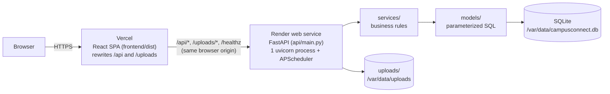

# Campus Connect

A college web application connecting students and faculty for academic communication
(**Mentor-Connect**), faculty meeting requests, supporting-faculty relationships, notifications and
administration, plus a separate scheduling-research component.

Campus Connect is a **React single-page app** (`frontend/`) talking to a **FastAPI JSON API**
(`api/`) that stores everything in **SQLite**. See `PRD.md` for the product requirements and `ESD.md`
for the engineering design (both carry a changelog for the architecture migration).

| Document | What it covers |
|---|---|
| [`DEPLOYMENT.md`](DEPLOYMENT.md) | Render (API) + Vercel (SPA) step by step, env tables, first admin, smoke checklist, backups, SQLite limits |
| [`DATABASE.md`](DATABASE.md) | Every table, ER and hierarchy diagrams, idempotent migration / backfill |
| [`docs/ACADEMIC_HIERARCHY.md`](docs/ACADEMIC_HIERARCHY.md) | Branch / Department / Year / Section model, Admin authority, access rules |
| [`docs/api/README.md`](docs/api/README.md) | Index of the API documentation (conventions, architecture, per-area endpoints) |
| [`frontend/README.md`](frontend/README.md) | SPA structure, design tokens, API client, how to add a page |
| [`research/README.md`](research/README.md) | Scheduling experiment: method, data, metrics, results |
| `.env.example` | Every environment variable the backend reads, plus the frontend ones (placeholders only) |

## 1. Architecture



* The browser only ever talks to **one origin**. In production Vercel serves the SPA and proxies
  `/api/*` and `/uploads/*` to Render, so the `cc_session` cookie is first-party and no CORS is needed. In
  development the Vite dev server (`:5173`) proxies the same paths to the API (`:5000`).
* The API can also serve the built SPA itself (`frontend/dist`, with an `index.html` fallback for client-side
  routes), which is handy for single-origin local runs.
* Layers: `api/routers` (HTTP, validation, auth) -> `services` (business rules, framework-agnostic) ->
  `models` (SQL). Details: [`docs/api/ARCHITECTURE.md`](docs/api/ARCHITECTURE.md).

## 2. Repository map

```
CampusConnect/
├── api/                    FastAPI app
│   ├── main.py             create_app(), lazy `app` (uvicorn api.main:app), router registration, scheduler
│   ├── settings.py         Settings dataclass + every environment variable
│   ├── security.py         ASGI middlewares: proxy headers, security headers / CSP, 10 MB cap, DB holder
│   ├── deps.py             auth / role / CSRF dependencies, request helpers
│   ├── db.py               sqlite3 connection handling, init_db(), additive migrations, seed
│   ├── errors.py           JSON error handlers, SPA index fallback
│   ├── schemas.py          shared response shapes
│   └── routers/            system, auth, account, academic, notifications, uploads, admin,
│                           admin_academic, faculty, student, chat, meetings, supporting, research
├── services/               business logic (auth, otp, academic, assignment, permission, chat, meeting,
│   │                       supporting, notification, file, session) + errors.py
│   └── scheduling/         RESEARCH ONLY: core engine, fcfs, rule_based, intelligent, metrics,
│                           simulator, experiment
├── models/                 schema.sql + SQL modules (queries, academic_queries, admin_queries,
│                           connect_queries, security_queries); database.py is a shim to api/db.py
├── frontend/               React 19 + Vite + Tailwind v4 + shadcn/ui SPA (own README, vercel.json)
├── research/               scheduling experiment entry point, data/, results/
├── docs/                   ACADEMIC_HIERARCHY.md, api/ (API contract and per-area endpoint docs)
├── tests/                  pytest suite (FastAPI TestClient, temp database per test)
├── scripts/backup_db.py    online SQLite backup (+ integrity check, pruning)
├── app.py                  tiny local runner (uvicorn)
├── create_admin.py         CLI: create an admin (interactive or --from-env)
├── render.yaml             Render Blueprint (API + persistent disk)
├── requirements.txt        runtime dependencies          requirements-dev.txt   + pytest, httpx2
├── requirements-research.txt   optional: matplotlib for the research charts
├── .env.example            documented environment variables
├── uploads/                profile/{students,faculty}, chat (contents git-ignored)
└── .github/workflows/ci.yml   backend tests + frontend lint/build
```

## 3. Local development

Requires Python 3.12 and Node 24 (any recent Node works).

### Backend (Windows)

```powershell
cd C:\dev\CampusConnect
python -m venv venv
venv\Scripts\python.exe -m pip install -r requirements-dev.txt     # runtime + test tools
copy .env.example .env                                              # then edit .env (git-ignored)

venv\Scripts\python.exe -m uvicorn api.main:app --reload --port 5000
# or the tiny runner (DEBUG=1 enables reload and the /docs pages):
venv\Scripts\python.exe app.py
```

macOS/Linux: `python3 -m venv venv && venv/bin/pip install -r requirements-dev.txt`, then
`venv/bin/python -m uvicorn api.main:app --reload --port 5000`.

Settings come from environment variables; a local `.env` is loaded automatically (real environment
variables win). In development with no `SECRET_KEY` a random key is stored in `.dev_secret_key`
(git-ignored) so sessions survive restarts. In production (`APP_ENV=production`) a strong `SECRET_KEY` is
mandatory. Every variable is listed in `.env.example`; the interactive API docs at `/docs` are only available
with `DEBUG=1`.

### Frontend

```powershell
cd frontend
npm install
npm run dev          # http://localhost:5173, proxies /api /uploads /healthz to http://127.0.0.1:5000
npm run dev:mock     # same, with an in-memory API mock (no backend needed)
npm run lint
npm run build        # -> frontend/dist (the API serves it when present)
```

Set `VITE_BACKEND_URL` to point the dev proxy somewhere other than `http://127.0.0.1:5000`.

### Database

The schema is created (and older databases are upgraded) automatically on start by
`api/db.init_db()`: tables use `CREATE TABLE IF NOT EXISTS`, missing columns are added with `ALTER TABLE`,
the default academic structure is seeded once and legacy free-text classes are linked to it. The file is
`database.db` in the repo root (override with `DATABASE_PATH`), git-ignored, and must never be committed.
To start fresh locally, stop the API and delete `database.db` (and any `-wal` / `-shm` files). Details:
[`DATABASE.md`](DATABASE.md).

### Creating the first admin

There is **no public admin signup**. Choose one:

```powershell
venv\Scripts\python.exe create_admin.py              # interactive (name, email, password prompts)
venv\Scripts\python.exe create_admin.py --from-env   # reads ADMIN_NAME, ADMIN_EMAIL, ADMIN_PASSWORD from the environment / .env
```

or set `BOOTSTRAP_ADMIN=1` with `ADMIN_NAME` / `ADMIN_EMAIL` / `ADMIN_PASSWORD` in `.env` (or the Render
dashboard) and the API creates that admin on start-up when the account does not exist (idempotent; an
existing password is never overwritten). Passwords need at least 8 characters with upper-case, lower-case and a
digit. Put real values only in your private `.env` or the hosting dashboard, never in tracked files.

### Tests

```powershell
venv\Scripts\python.exe -m pytest tests -q
cd frontend; npm run lint; npm run build
```

CI (`.github/workflows/ci.yml`) runs the backend tests on Python 3.12 and the frontend `npm ci`, lint and
build on Node 24, on every push and pull request.

## 4. Academic hierarchy (summary)

Admin owns the structure **Branch -> Department -> Year -> Section**. The default seed is branch `CSE` with
departments `AIML`, `AIDE`, `GenAI`, `Cybersecurity`, `Blockchain`, `IoT`, years `1st` to `4th` and sections
`A` to `C`.

- Students pick their class once at registration and cannot change it; Admin can **remove the registration**
  so the student can register again in the right class.
- Faculty have no classes at signup. Admin assigns them (many sections per faculty, several faculty per
  section) or approves their **class requests**.
- Faculty reach students, and students reach faculty, only through an active class assignment or an accepted
  supporting-faculty relationship, enforced server-side for chat, meetings, search, supporting requests and
  profile approvals.

Full rules and the file that implements each check: [`docs/ACADEMIC_HIERARCHY.md`](docs/ACADEMIC_HIERARCHY.md).

## 5. Demo usage

1. **Admin** signs in (account from section 3), reviews **Academics**, then **Assignments**.
2. **Faculty** registers (name, Faculty ID, department, subjects, professional email, password), then asks
   for classes, or Admin assigns them directly.
3. **Student** registers: college email, OTP (shown on screen in demo mode, e-mailed if SMTP is configured),
   then details including the Branch / Department / Year / Section.
4. Users sign in with email (students and faculty can also use USN / Faculty ID).
5. The student opens **Mentor-Connect** to message the faculty assigned to their class, or finds other
   faculty and sends a **supporting-faculty request** (the faculty member must accept before chat or meetings
   are permitted).
6. The student sends a **meeting request**. Faculty accepts or rejects it and, on accept, types the time as
   free text (for example "Tomorrow after 3:30 PM"): no calendar, no fixed duration, no automatic slots.
7. Either party can mark a meeting **Completed** or **Cancel** it (students must give a reason). Open
   meetings keep receiving reminders; there is no automatic expiry.
8. Phone / personal-email changes need approval (student -> an in-scope class faculty; faculty changes ->
   Admin). Nothing is applied until approved.

## 6. Security features

- Passwords hashed with Werkzeug (salted); password policy enforced; college-email passwords are never requested.
- Login throttling and temporary lockout per account and per IP (`login_attempts` table); one generic error for
  unknown user / wrong password / inactive account.
- Signed session cookie `cc_session`: `HttpOnly`, `SameSite=Lax`, `Secure` in production, absolute (12 h) and
  idle (60 min) timeouts; the user's role and active flag are re-read from the database on every request.
- CSRF protection on every `POST/PUT/PATCH/DELETE` (header `X-CSRFToken`, constant-time comparison, enforced by
  one app-level dependency so no router can forget it).
- Security headers on every response (strict CSP with `script-src 'self'`, `X-Frame-Options: DENY`,
  `X-Content-Type-Options`, `Referrer-Policy`, `Permissions-Policy`, HSTS in production); every `/api/*`
  response is `Cache-Control: no-store`; 10 MB request cap.
- Strict request validation (pydantic, unknown fields rejected) and uniform JSON errors that never leak
  internals or raw database errors.
- Production refuses to start with a missing or short `SECRET_KEY`; no default admin credentials; secrets come
  only from the environment; `/docs` is disabled in production.
- Role and ownership checks are server-side (`api/deps.require_role` plus per-record checks in services);
  class-scope rules are in `docs/ACADEMIC_HIERARCHY.md`.
- Uploads are validated by extension, size and content, stored under generated names and served only to
  authorised signed-in users through `/uploads/*` (non-images as downloads).
- All SQL is parameterized. Signup OTP is rate limited and hashed at rest.
- Proxy-aware client IP (`TRUST_PROXY`, `TRUST_PROXY_HOPS`) so rate limiting works behind Vercel and Render.

## 7. Scheduling research (summary)

Kept entirely separate from the live application: it never touches real student or faculty accounts. Question:
can data-driven scheduling reduce student waiting time and improve meeting efficiency compared with the
manual approach? One simulated college week, three methods on identical synthetic requests: **FCFS / manual**,
**rule-based**, **intelligent** (transparent weighted scoring, no machine learning). Results, assumptions and
limitations: [`research/README.md`](research/README.md) and `research/results/comparison.md`. Run it with:

```powershell
venv\Scripts\python.exe -m pip install -r requirements-research.txt   # matplotlib, for the charts only
venv\Scripts\python.exe research\run_experiment.py
```

Admins can view the committed results (and rerun a quick simulation) in the SPA under **Research**
(`/api/research/*`, see `docs/api/research.md`).

## 8. Deployment summary

**Render** hosts the API (single uvicorn process, persistent disk at `/var/data` for the SQLite file and
uploads, health check `/healthz`); **Vercel** hosts the React SPA and rewrites `/api` and `/uploads` to Render.

1. Render: *New -> Blueprint*, select the repo, enter `ADMIN_NAME` / `ADMIN_EMAIL` / `ADMIN_PASSWORD`, apply (paid
   **Starter** plan needed for the disk).
2. Vercel: *New Project*, import the repo, **Root Directory = `frontend`**, set `BACKEND_URL` to the Render URL
   (or run `npm run set-backend-url -- https://<service>.onrender.com` in `frontend/` and commit
   `frontend/vercel.json`), deploy.

Step by step, the free-plan data-loss warning, backups and limits: [`DEPLOYMENT.md`](DEPLOYMENT.md).

## 9. Design constraints honored

No booking calendar, no fixed meeting duration, no automatic faculty availability, no automatic no-show or
expiry, no message deletion, no public admin signup, no college-email password storage, no paid OTP service:
see `PRD.md` section 17 and `ESD.md` section 39 for the full list this implementation was built against.
